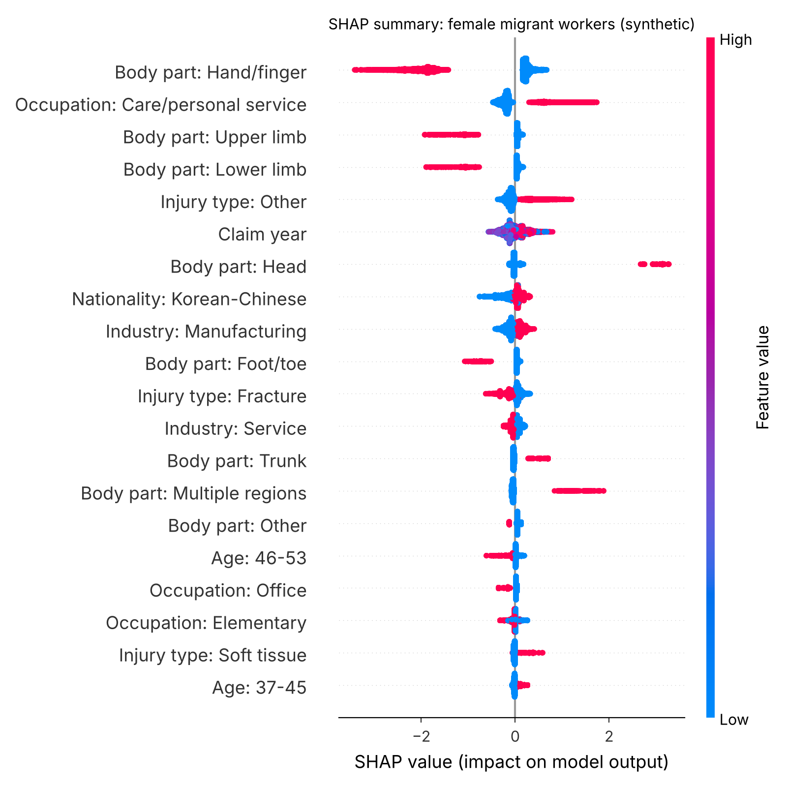

# Interpretable machine learning for fatal occupational injuries

Code accompanying:

> **Lee JY**, Lee W, Cho SI. Characteristics of fatal occupational injuries in migrant workers in South Korea: a machine learning study. *Heliyon*. 2023;9(9):e20138. [doi:10.1016/j.heliyon.2023.e20138](https://doi.org/10.1016/j.heliyon.2023.e20138)

The study used XGBoost and SHapley Additive exPlanations (SHAP) to look for factors linked to fatal occupational injury among migrant workers in South Korea. It ran the analysis separately for men and women and compared the results with logistic regression. The main finding was a gender difference: occupation predicted fatality only among female migrant workers, and care jobs carried the highest risk. That pattern would have been missed without gender-stratified, job-specific analysis.

This repository reproduces the **analysis workflow** on synthetic data.

## About the data

The original data were workers' compensation claims from the Korea Workers' Compensation and Welfare Service (KCOMWEL), January 2007 to September 2018, n = 67,576. The authors are not permitted to share them.

`src/01_generate_synthetic_data.py` creates an artificial dataset with the same structure: one row per approved injury claim, eight features and a fatal/non-fatal outcome. Marginal distributions roughly follow the paper's descriptive table. No row corresponds to a real person.

The outcome is simulated from a known model with **planted gender interactions**: care jobs, pharmaceutical manufacturing and trunk injuries are riskier for women, and amputation is riskier for men. Because the true process is known, the pipeline can be checked for whether it recovers these effects.

**The numbers in `results/` describe the synthetic data, not the study.** For the actual findings, see the paper.

## Pipeline

| Step | Script | What it does | Paper section |
|---|---|---|---|
| 1 | `01_generate_synthetic_data.py` | Builds the synthetic claims dataset (67,576 rows, ~1.6% fatal) | 2.1-2.3 |
| 2 | `02_model_comparison.py` | Logistic regression (backward stepwise AIC), random forest and XGBoost; holdout AUROC, sensitivity, specificity; 10-fold CV for XGBoost | 2.4, 3.3 |
| 3 | `03_shap_analysis.py` | TreeSHAP on XGBoost for all, male and female workers; top-20 summary plots; mean \|SHAP\| rankings by gender; SHAP interaction values | 2.5, 3.2 |

XGBoost uses the final hyperparameters reported in the paper: eta = 0.3, gamma = 1, max_depth = 6, n_estimators = 500, colsample_bytree = 1.

## Run it

```bash
pip install -r requirements.txt
cd src
python 01_generate_synthetic_data.py
python 02_model_comparison.py
python 03_shap_analysis.py
```

The whole run takes about a minute and a half on a laptop. Outputs go to `results/figures/` and `results/tables/`.

## What the synthetic run shows

**SHAP recovers the main gender finding.** In the female-only model, *Occupation: Care/personal service* ranks second of all features and pushes risk up. In the male model it has no effect.



**Rare subgroups are a limit of the tree model.** `results/tables/planted_effects_check.csv` compares each planted interaction with what SHAP found:

| Planted effect | Mean SHAP, female model | Mean SHAP, male model | Recovered? |
|---|---|---|---|
| Care/personal service raises risk (women only) | +0.83 | 0.00 | Yes |
| Trunk injury raises risk (stronger in women) | +0.55 | +0.51 | Direction only |
| Amputation raises risk (men only) | 0.00 | +0.07 | Weakly |
| Pharmaceutical manufacturing raises risk (women only) | 0.00 | -0.08 | No: too few female deaths in this cell |

With only about 55 female deaths, some cells contain no events, and the model cannot learn from them. A few features in the female model, such as claim year and nationality, also pick up noise. This is why the paper recommends checking individual cases before interpreting SHAP values at scale. The follow-up fishery study answered the same problem by adding a confirmatory stage with Firth-penalized logistic regression (see [rare-event-firth-regression](https://github.com/inezkorea/rare-event-firth-regression)).

**Model performance is similar here, by design.** Holdout AUROC is 0.939 for logistic regression, 0.930 for random forest and 0.933 for XGBoost. The synthetic outcome comes from a mostly additive logistic model, which logistic regression fits well. In the real data, XGBoost reached AUROC 0.992, sensitivity 0.961 and specificity 0.967. The point of this repository is the workflow, not the score.

## Notes on method

- SHAP describes how the model uses each feature. It does not show causation.
- TreeSHAP was chosen over KernelSHAP because it is exact for tree models, faster, and does not assume feature independence.
- The paper detected interactions with the R packages `DALEX` and `EIX`. This repository uses SHAP interaction values in Python for the same purpose.
- The paper's analysis used Python 3.8 and R 3.6. This repository was tested with Python 3.13, xgboost 3.4 and shap 0.54. Results are reproducible with the fixed seed in `config.py`.

## Repository structure

```
├── data/synthetic_injuries.csv     # generated by step 1
├── results/
│   ├── figures/                    # ROC curves, SHAP summary plots
│   └── tables/                     # performance, SHAP rankings, interactions
└── src/
    ├── config.py                   # paths, seed, XGBoost hyperparameters
    ├── 01_generate_synthetic_data.py
    ├── 02_model_comparison.py
    └── 03_shap_analysis.py
```

## Citation

If you use this code, please cite the paper above. Citation metadata is in `CITATION.cff`.

## License

Code: MIT. The synthetic data may be reused freely.

## Contact

Ju-Yeun Lee · inezkorea@snu.ac.kr · [ORCID 0000-0001-7348-3240](https://orcid.org/0000-0001-7348-3240)
